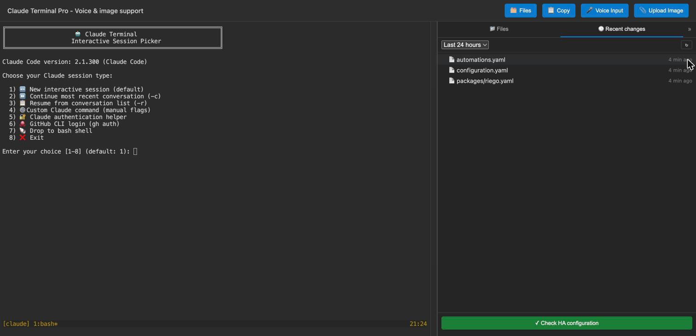

<div align="center">


# Claude Terminal Pro for Home Assistant

**Claude Code inside your Home Assistant sidebar.** A browser terminal with the tools you need for HA work, a session that survives restarts, and a file panel to see what Claude changed.

[](claude-terminal/CHANGELOG.md)
[](https://github.com/ESJavadex/claude-code-ha/releases)
[](LICENSE)
[](#architecture-support)
[](https://github.com/ESJavadex/claude-code-ha/stargazers)

[](https://my.home-assistant.io/redirect/supervisor_add_addon_repository/?repository_url=https%3A%2F%2Fgithub.com%2Fesjavadex%2Fclaude-code-ha)



</div>

## What's new

- **2.2: Files sidebar.** A tree of `/config`, a *Recent changes* list showing what Claude just edited, and a button that runs Home Assistant's config check before you restart. It sits on the right and collapses to a thin rail.
- **2.1: community release.** New installs build in seconds again. Copy and paste work properly, including on phones. The session picker no longer freezes after a crash. New options: `init_commands`, `working_directory`, `enable_remote_control`, `claude_code_oauth_token` and `claude_extra_args`. Security is tighter too: ingress only by default.

Full history in the [changelog](claude-terminal/CHANGELOG.md).

> [!IMPORTANT]
> **Updating from 2.0.x?** Ports 7680 and 7681 are now closed by default, because both served a root shell with no login. The sidebar panel works exactly as before. If you opened the terminal at `http://<ha>:7681`, set the port again under the add-on's **Network** settings, and read [Security](#security) first.

## Install

1. Click the button above, or go to **Settings → Add-ons → Add-on Store → ⋮ → Repositories** and add `https://github.com/esjavadex/claude-code-ha`
2. Install **Claude Terminal Pro** and start it
3. Open **Claude Terminal Pro** from the sidebar and log in to Claude when asked

Claude's login link also shows up as a Home Assistant notification (and in the Companion app), so you can open it with one tap. No API key is needed for a normal setup.

## Features

**Terminal**
- Claude Code in a web terminal embedded in the HA sidebar, starting in `/config`
- A persistent tmux session: close the tab or restart HA Core and you reattach to the same conversation
- An optional session picker: new, continue, resume, custom flags, auth helper, `gh` login, bash
- Copy and paste that work: mouse selection, Claude's `/copy`, **Copy** and **Copy link** buttons, swipe to scroll on touch screens
- Paste, drop or upload images for Claude to look at; voice input

**Files sidebar**
- A read-only tree of `/config` with previews. **Insert path** types a file's path at the prompt
- **Recent changes**: files changed in the last hour, day or week
- **✓ Check HA configuration** runs `ha core check`

**Home Assistant tooling**
- The `ha` and `gh` CLIs, git, Python 3, Node.js, jq, yq, vim, nano and tree are included
- Access to the Supervisor and Core APIs, plus Claude skills and commands for HA work
- Remote Control: drive the same session from the Claude app or claude.ai/code

**Persistence**
- Login, settings, history and packages live in the add-on's `/data` and survive restarts and updates
- `persist-install` for APK and pip packages that survive reboots, plus auto-install lists in the config
- `init_commands` to start your own scripts or services on every boot
- Optional persistent Claude install with an **Update Claude Code** option in the session picker
- Lean backups: caches and files that can be downloaded again are left out

## Configuration

| Option | Default | What it does |
| --- | --- | --- |
| `auto_launch_claude` | `true` | Start Claude straight away, or show the session picker |
| `working_directory` | `/config` | Folder the terminal and Claude start in |
| `claude_code_oauth_token` | empty | Long-lived token from `claude setup-token`, instead of the browser login |
| `enable_remote_control` | `false` | Also expose the session in the Claude app and at claude.ai/code |
| `claude_extra_args` | empty | Extra flags for every launch, e.g. `--model claude-sonnet-5-5` (quoting works) |
| `dangerously_skip_permissions` | `false` | Let Claude run tools without asking. Read [Security](#security) first |
| `tmux_mouse` | `false` | tmux mouse mode. Keep it off for native browser copy and paste |
| `persistent_apk_packages` | `[]` | Alpine packages installed on every start |
| `persistent_pip_packages` | `[]` | Python packages installed on every start |
| `init_commands` | `[]` | Shell commands run on every start, after packages (120 s each) |
| `use_persistent_claude` | `false` | Use a Claude Code install kept in `/data/npm` |
| `auto_update_claude_on_start` | `false` | Update that persistent install on every start |

```yaml
auto_launch_claude: true
working_directory: /config
persistent_apk_packages:
  - ripgrep
persistent_pip_packages:
  - httpx
init_commands:
  - nohup /config/scripts/my-bridge.sh > /config/scripts/bridge.log 2>&1 &
```

Every option is explained in [DOCS.md](claude-terminal/DOCS.md).

## Quick start

```bash
claude                                 # interactive session
claude "Write an automation that turns on the porch light at sunset"
persist-install ripgrep                # survives restarts
persist-install --python httpx
ha core check                          # or the button in the sidebar
```

## Security

This add-on gives Claude a lot of power by design. It runs as root in its container, can write anywhere in `/config`, and can call the Supervisor and Home Assistant APIs.

- **Any signed-in Home Assistant user can reach it**, not only admins. That's how ingress works in HA. Treat every account on your instance as trusted while it's installed.
- **Ports 7680 and 7681 are closed by default.** Opening one gives anyone on your network a root shell with no login.
- **The web UI only accepts Home Assistant's ingress proxy**, and ttyd listens only inside the container.
- **The Files sidebar is read-only and limited to `/config`.** Your Claude login in `/data` can't be browsed.
- **`dangerously_skip_permissions` removes the last human check.** A prompt injection in any file or page Claude reads could change your config without asking.

More in [DOCS.md → Security](claude-terminal/DOCS.md#security).

## Architecture support

| Architecture | Claude Code | Home Assistant CLI | GitHub CLI |
| --- | --- | --- | --- |
| `amd64` | native, latest | latest | latest |
| `aarch64` | native, latest | latest | latest |
| `armv7` | portable JS `1.0.128` ¹ | `4.46.0` ² | `armv6` build ³ |

¹ Current Claude Code native releases do not publish a 32-bit ARM binary, so armv7 uses the last portable JavaScript release.
² `4.46.0` is the last HA CLI release that still ships the `ha_armv7` asset (later releases dropped it).
³ GitHub CLI has no armv7 build; the armv6 binary runs on armv7 and is pinned to a version verified to publish it.

The target architecture is resolved from Home Assistant's `BUILD_ARCH` build argument, so the image builds correctly on each device without relying on BuildKit-specific variables.

## Troubleshooting

- **The session picker doesn't react to the keyboard.** Update to 2.1.13 or later.
- **Typing lags, then catches up.** That comes from Home Assistant's ingress proxy, not the add-on. See [DOCS.md](claude-terminal/DOCS.md#typing-lags-or-pauses-for-a-few-seconds-then-catches-up).
- **`persist-install` packages vanish after a restart.** Fixed in 2.1.13. Install them again once.
- **Anything else:** check the add-on log and [open an issue](https://github.com/ESJavadex/claude-code-ha/issues).

## Recommended: Home Assistant plugins for Claude

Pair the add-on with the **[Claude Home Assistant Plugins](https://github.com/ESJavadex/claude-homeassistant-plugins)** for HA-specific context and tools:

```bash
npx claude-plugins install @ESJavadex/claude-homeassistant-plugins/homeassistant-config
```

## Community tools

- **[ha-ws-client-go](https://github.com/schoolboyqueue/home-assistant-blueprints/tree/main/scripts/ha-ws-client-go)** by [@schoolboyqueue](https://github.com/schoolboyqueue) — lightweight Go CLI for the Home Assistant WebSocket API. Gives Claude direct access to entity states, service calls, automation traces, and real-time monitoring. Single binary, no dependencies.

## Contributors

This add-on keeps getting better thanks to people who send fixes, test releases and write detailed bug reports. Thank you all. 💙

<table>
  <tr>
    <td align="center"><a href="https://github.com/nsleigh"><br /><sub><b>nsleigh</b></sub></a></td>
    <td align="center"><a href="https://github.com/PeterLinuxOSS"><br /><sub><b>PeterLinuxOSS</b></sub></a></td>
    <td align="center"><a href="https://github.com/mmackenzie2026"><br /><sub><b>mmackenzie2026</b></sub></a></td>
    <td align="center"><a href="https://github.com/miczu71"><br /><sub><b>miczu71</b></sub></a></td>
    <td align="center"><a href="https://github.com/RobSlabaugh"><br /><sub><b>RobSlabaugh</b></sub></a></td>
    <td align="center"><a href="https://github.com/owine"><br /><sub><b>owine</b></sub></a></td>
    <td align="center"><a href="https://github.com/heytcass"><br /><sub><b>heytcass</b></sub></a></td>
  </tr>
</table>

<a href="https://github.com/ESJavadex/claude-code-ha/graphs/contributors">
  
</a>

- [@nsleigh](https://github.com/nsleigh) carried the project through the 2.1.x series: the session picker update option, paste in the terminal, security hardening, offline startup, smaller backups, the login notification, the new launch options and a build that can't hang.
- [@PeterLinuxOSS](https://github.com/PeterLinuxOSS) made copying out of the terminal work, with touch-device copy and swipe scrolling.
- [@mmackenzie2026](https://github.com/mmackenzie2026) fixed `persist-install` so packages really persist.
- [@miczu71](https://github.com/miczu71), [@RobSlabaugh](https://github.com/RobSlabaugh), [@owine](https://github.com/owine) and [@martinboksa](https://github.com/martinboksa) sent earlier fixes and ideas.
- [@heytcass](https://github.com/heytcass) (Tom Cassady) created the original [Claude Terminal add-on](https://github.com/heytcass/home-assistant-addons) this project is forked from.

Want to help? PRs are welcome. Smaller, focused ones get reviewed fastest. See the [development guide](DEVELOPMENT.md) to build and test locally.

## License

MIT, the same as the original. See [LICENSE](LICENSE).

## About the author

Maintained by **Javier Santos** ([@ESJavadex](https://github.com/ESJavadex)) — AI consultant and founder of [Javadex](https://www.javadex.es/), where I help companies run private AI platforms. I also build [Cortex](https://www.javadex.es/plataforma), a self-hosted multi-model AI platform (the same "your AI, your data" philosophy as this add-on). More AI + Home Assistant content (in Spanish) on the [Javadex blog](https://www.javadex.es/blog).
