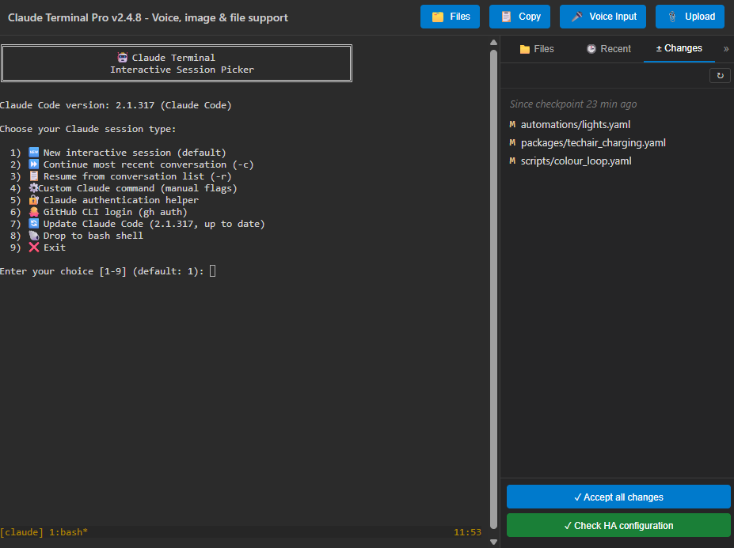

# Claude Terminal Pro for Home Assistant

Claude Code inside your Home Assistant sidebar: a browser terminal with the tools you need for HA work, a session that survives restarts, and a side panel to see, check and undo what Claude changed.

*Claude Terminal Pro running in Home Assistant*

> **Fork Attribution:** This is an enhanced fork of [heytcass/home-assistant-addons](https://github.com/heytcass/home-assistant-addons) by Tom Cassady, maintained by Javier Santos ([@esjavadex](https://github.com/esjavadex)).

📖 **Full documentation:** every option, the panel's features, security and troubleshooting. In Home Assistant, open the **Documentation** tab at the top of this page; on GitHub, see [DOCS.md](https://github.com/ESJavadex/claude-code-ha/blob/main/claude-terminal/DOCS.md).

## Features

**Terminal**
- Claude Code in a web terminal in the sidebar, starting in `/config`
- A persistent tmux session: close the tab or restart Home Assistant Core and you reattach to the same conversation
- An optional session picker: new, continue, resume, custom flags, login helper, `gh` login, bash
- Copy and paste that work, including on phones, with a row of terminal keys above the on-screen keyboard
- Paste, drop or upload images and other files (PDFs, text, YAML, logs…) for Claude to read
- Voice input through your Home Assistant speech-to-text engine
- A status line under Claude's prompt: context, plan limits, and anything in the home that needs a look
- The Home Assistant plugin for Claude, preinstalled: current HA syntax, a check of every YAML file Claude writes, `/ha-check` and `/ha-upgrade`

**Files sidebar**
- A read-only tree of `/config` with previews, and the files changed in the last hour, day or week
- **± Changes**: everything changed since the last checkpoint, with **Revert file** and **Accept all changes** (local git, never pushed)
- **✓ Check HA configuration** runs `ha core check` before you restart

**Home Assistant tooling**
- The `ha` and `gh` CLIs, git, Python 3, Node.js, jq, yq, vim, nano and tree
- Access to the Supervisor and Core APIs
- Remote Control: drive the same session from the Claude app or claude.ai/code

**Persistence**
- Your login, settings, history and packages live in the add-on's own `/data` and survive restarts and updates
- `persist-install` for Alpine and pip packages that survive reboots, plus lists in the options to install them on every start
- `init_commands` to start your own scripts or services on every boot
- Lean backups: caches and files that can be downloaded again are left out

## Installation

You need a Claude subscription that includes Claude Code, or an Anthropic Console
account with API billing. Claude Code isn't included in the free Claude plan. See
[Claude Code account requirements](https://code.claude.com/docs/en/quickstart).

1. Go to **Settings → Add-ons → Add-on Store → ⋮ → Repositories** and add `https://github.com/esjavadex/claude-code-ha`
2. Install **Claude Terminal Pro** and start it
3. Open **Claude Terminal Pro** from the sidebar and log in to Claude when asked

Claude's login link also shows up as a Home Assistant notification (and in the Companion app), so you can open it with one tap. With a Claude plan, no API key is needed.

## Configuration

It works without changing anything. Each option has a description in the **Configuration** tab, and the Documentation tab covers them in detail. The main ones:

- **Start-up:** `auto_launch_claude` (or show the session picker), `working_directory`, `claude_extra_args`, `enable_remote_control`
- **Login:** `claude_code_oauth_token`, a long-lived token instead of the browser login
- **Packages:** `persistent_apk_packages`, `persistent_pip_packages` and `init_commands`, run on every start
- **Claude Code itself:** `use_persistent_claude` and `auto_update_claude_on_start` for an install kept in `/data`
- **Panel:** `statusline`, `voice_stt_provider`, `voice_language` and `tmux_mouse`
- **Home Assistant plugin for Claude:** `home_assistant_plugin` (on by default), the bundled plugin that teaches Claude current HA syntax and checks the YAML it writes

## Security

This add-on gives Claude a lot of power by design. It runs as root in its container, can write anywhere in `/config`, and can call the Supervisor and Home Assistant APIs.

- ⚠️ **Any signed-in Home Assistant user can reach it**, not only admins. That's how ingress works in Home Assistant. Treat every account on your instance as trusted while it's installed.
- 🔒 **Ports 7680 and 7681 are closed by default.** Both serve a root shell with no login, so opening one gives that shell to anyone who can reach the port.
- 🔒 **Only Home Assistant's ingress proxy can reach the panel**, and ttyd listens only inside the container.
- ⚠️ **`dangerously_skip_permissions` removes the last human check.** A prompt injection in any file or page Claude reads could change your config without asking.

More in [DOCS.md → Security](https://github.com/ESJavadex/claude-code-ha/blob/main/claude-terminal/DOCS.md#security).

## Troubleshooting

- **The terminal doesn't load:** check the add-on's **Log** tab, then restart the add-on.
- **Typing lags, then catches up:** that comes from Home Assistant's ingress proxy, not the add-on. See [DOCS.md](https://github.com/ESJavadex/claude-code-ha/blob/main/claude-terminal/DOCS.md#typing-lags-or-pauses-for-a-few-seconds-then-catches-up).
- **Logging in fails:** choose the login helper in the session picker (set `auto_launch_claude` to `false` to see the picker).
- **Anything else:** [open an issue](https://github.com/ESJavadex/claude-code-ha/issues).

## Useful Links

- [Claude Code documentation](https://code.claude.com/docs)
- [Claude plans that include Claude Code](https://claude.com/pricing)
- [Anthropic Console (API billing)](https://console.anthropic.com/)
- [Changelog](https://github.com/ESJavadex/claude-code-ha/blob/main/claude-terminal/CHANGELOG.md)
- [Developing the add-on](https://github.com/ESJavadex/claude-code-ha/blob/main/DEVELOPMENT.md)

## Credits

**Original Creator:** Tom Cassady ([@heytcass](https://github.com/heytcass)) - Created the initial Claude Terminal add-on
**Fork Maintainer:** Javier Santos ([@esjavadex](https://github.com/esjavadex)) - Added persistent package management and enhancements

This add-on was created and enhanced with the assistance of Claude Code itself! The development process, debugging, and documentation were all completed using Claude's AI capabilities - a perfect demonstration of what this add-on can help you accomplish.

## License

This project is licensed under the MIT License - see the [LICENSE](https://github.com/ESJavadex/claude-code-ha/blob/main/LICENSE) file for details.
